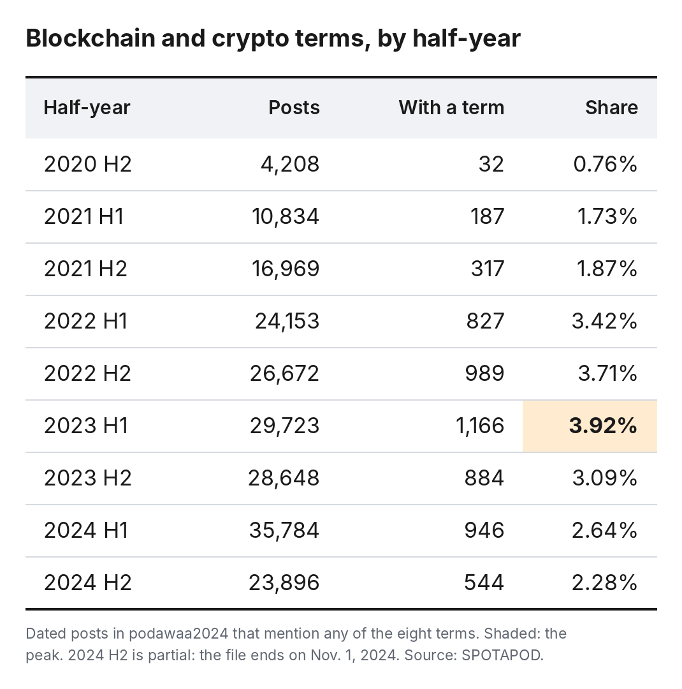
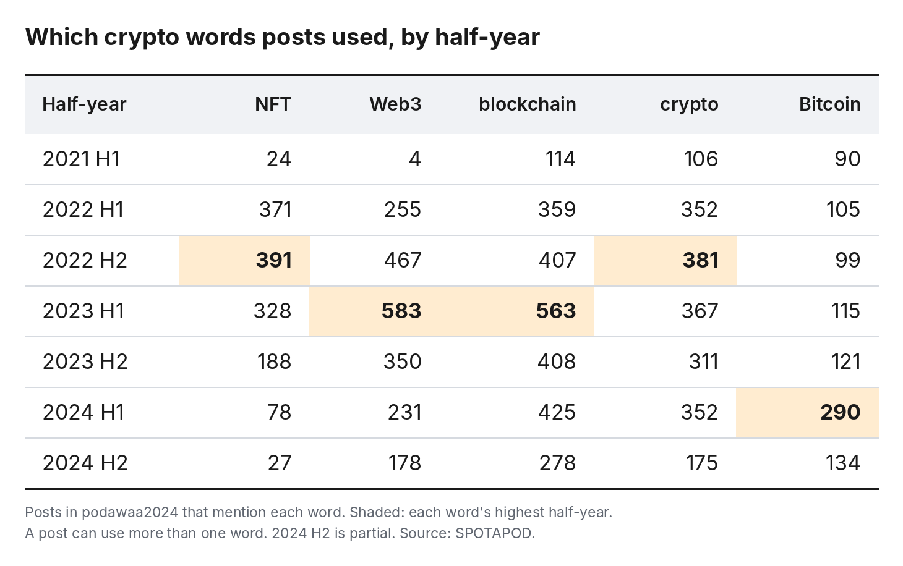
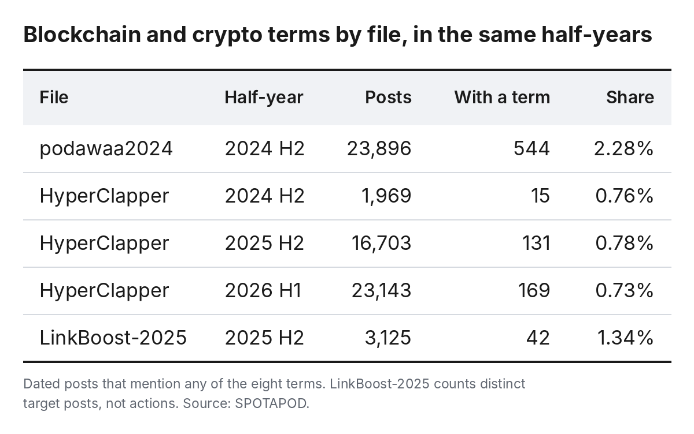

# Crypto Posts Rose Fivefold, Then Fell by Two-Fifths, Inside One Tool's Files

### In podawaa2024, blockchain and crypto terms went from 0.76% of dated posts in late 2020 to 3.92% in early 2023 and 2.28% in late 2024

An earlier piece in this series, [The Rise and Fall of Blockchain Content](the-rise-and-fall-of-blockchain-content.md), compared two datasets and found blockchain and crypto terms about four times less common in HyperClapper (0.774%) than in podawaa2024 (2.930%). That comparison cannot separate time from tool. The two files come from different pod tools, and they cover different years.

This piece puts each file on a half-year axis, using the date decoded from each post's LinkedIn ID. That lets a trend be read inside one tool.

## One tool, 2020 to 2024

podawaa2024.json holds 201,000 distinct posts with a decodable date. This table shows the share that mention any of the eight terms used in the [blockchain and crypto scan](../research/blockchain-crypto-content.md). The file ends in early November 2024, so 2024 H2 is a partial half-year. 2020 H1 is left out because it holds only 111 posts.

The share rose about fivefold, from 0.76% to 3.92%, by the first half of 2023. It then fell by about 42%, to 2.28%. The fall inside one tool is real, and it is smaller than the four-times gap between datasets.

## Which words changed

The terms did not fall together. A post can mention more than one, so the columns overlap.

NFT mentions peaked in 2022 H2 at 391 and fell to 27 by 2024 H2. In 2022 H1, 371 of the 827 posts with a term (45%) mentioned NFTs. In 2024 H2 it was 27 of 544 (5%). Web3 and blockchain peaked a half-year later, in 2023 H1, at 583 and 563. Bitcoin stayed near 100 per half-year until 2023 H2, then reached 290 in 2024 H1.

## Different tools, same half-year

The other two datasets cover later years, and they do not fill in the same series.

In 2024 H2, the one half-year that podawaa2024 and HyperClapper share, podawaa2024's rate is about three times HyperClapper's. In 2025 H2, LinkBoost-2025's rate is about 1.7 times HyperClapper's. Tool differences are about as large as the change over time, so a gap between two datasets says little about a trend.

Inside HyperClapper, the two half-years with more than 16,000 posts each, 2025 H2 and 2026 H1, show 0.78% and 0.73%. No further fall is visible there. HyperClapper's half-years before 2025 H2 hold fewer than 4,000 posts each, and LinkBoost-2025's 3,129 distinct dated posts are nearly all from 2025 H2, so neither file gives a longer series.

## What this is, and isn't

**VERIFIED**, reproducible via the published scan: every count and share in the three tables. Each post counts once, by its LinkedIn post ID. Command and full output: [the half-year series](../research/blockchain-crypto-content.md#the-half-year-series).

**VERIFIED**, by arithmetic on those counts: the fivefold rise and the 42% fall inside podawaa2024, and the 3x and 1.7x gaps between tools.

**INFERENCE**: the dates. They come from a Snowflake-style decode of the LinkedIn post ID, which LinkedIn has not documented. See [method](../method.md).

**INFERENCE**: any reason for the rise or the fall. The files do not say why posts mention these terms more or less often. The earlier piece's link to AI content is still not established by these counts.

Two limits apply to all of it. A match is a keyword in the text, not a finding about the post. And the files hold the posts that reached each pod tool, so the shares describe those files and not LinkedIn as a whole.

Full methodology: **github.com/DreamITSoftware/SPOTAPOD**.

---

*Self-published. Not peer-reviewed. Independently reproducible from the source files.*
